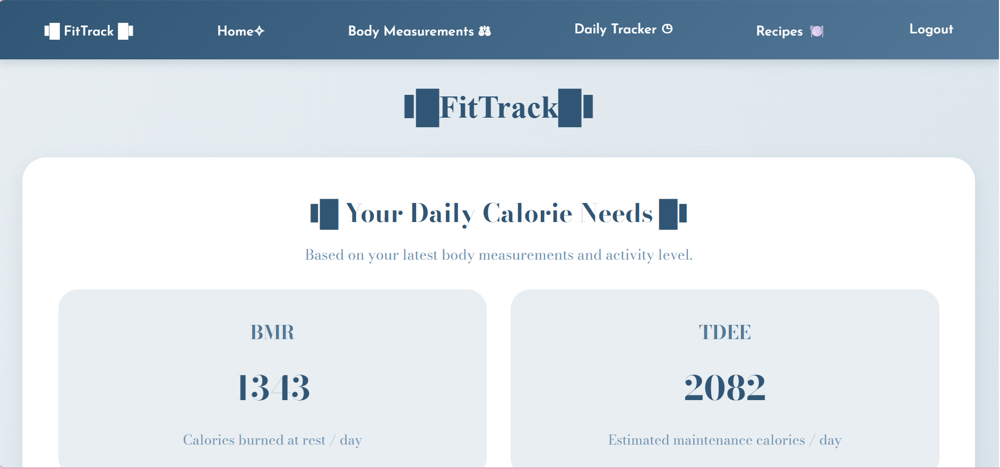
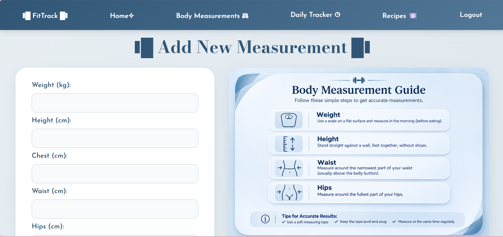
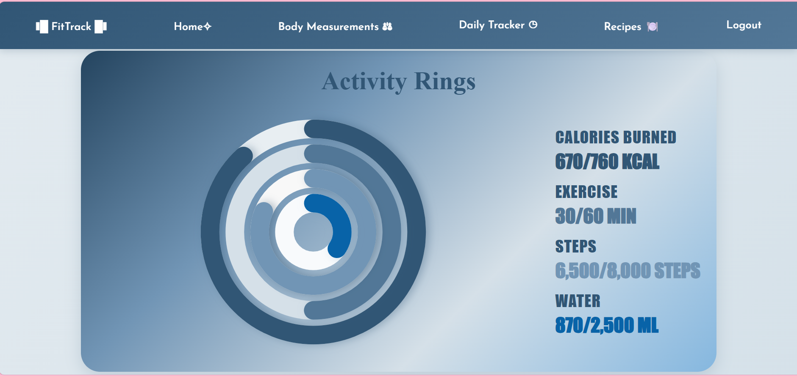
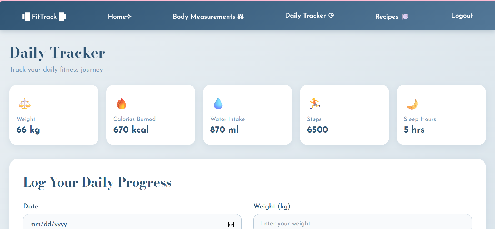
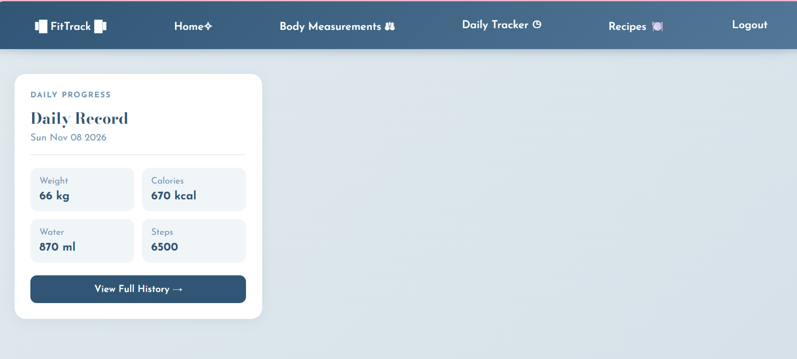
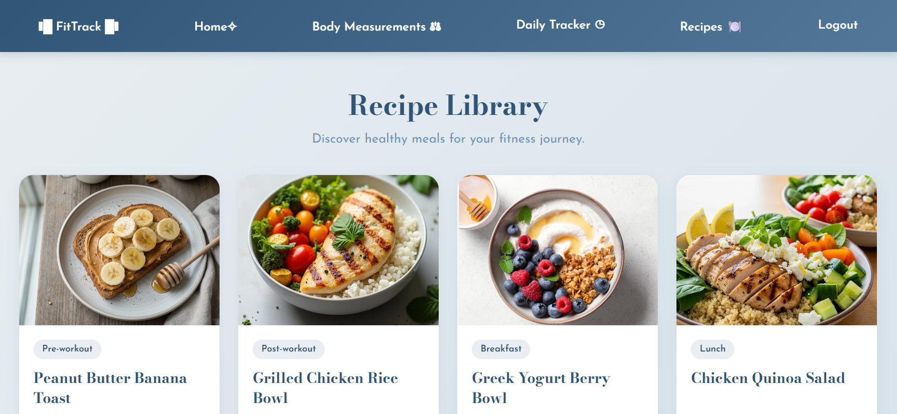
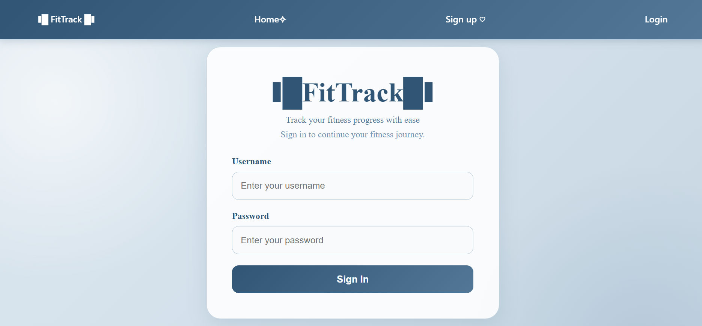
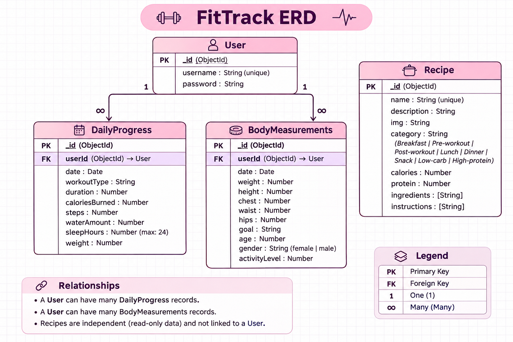

# Project Name
FitTrack

## Overview
FitTrack is a web-based fitness management application that helps users track workouts, record body measurements, manage fitness goals, monitor nutrition and water intake, and analyze their progress over time.

## Screenshots

## Technologies Used
1. javascript
2. css
3. server.js
4. Html 
5. MongoDB
6. Ejs 
7. Express.js

# Project structure

3 MAIN MODULES

1. daily progress: workouts he did, water he intake, sleep
2. Body Measurements: height, weight, hips ,goals
3. user

# FitTrack – User Stories

# Body Measurements: height, weight, hips ,goals

1. As a user, I want to record my body weight so that I can monitor my weight changes. 
2. As a user, I want to record my height so that I can maintain my body information. 
3. As a user, I want to record my waist and hip measurements so that I can track body changes.
4. As a user, I want to add notes to my measurement records so that I can save additional information
5. As a user, I want to view my measurement history so that I can compare previous measurements. 
6. As a user, I want to edit my body measurements so that I can correct or update my records. 
7. As a user, I want to delete measurement records so that I can remove incorrect entries. 
8. As a user, I want to record my fitness goals so that I can keep track of my targets.

# daily progress: workouts he did, water he intake, sleep
1. As a user, I want to record my workout type so that I can track my physical activities. 
2. As a user, I want to record my workout duration so that I can monitor my training time. 
3. As a user, I want to record calories burned so that I can monitor my workout performance. 
4. As a user, I want to record my daily water intake so that I can track my hydration. 
5. As a user, I want to record my sleep hours so that I can monitor my sleeping habits.
6. As a user, I want to view my daily progress records so that I can review my activities.
7. As a user, I want to edit my daily progress records so that I can correct incorrect information. 
8. As a user, I want to delete daily progress records so that I can remove unwanted entries.

## Database Design

## Routes
Method	Route	Description
GET	| / |Display the homepage and fitness dashboard
GET	|/measurements | Display body measurements
POST | /measurements	| Add new body measurements
GET	| /measurements/edit/:id	| Display the edit measurement form
PUT	| /measurements/:id | Update body measurements
DELETE | /measurements/:id| Delete body measurements
GET	 | /daily |Display the daily tracker page
POST | /daily | Add a new daily progress record
GET	| /daily/history	| Display daily progress history
GET	| /recipes/ | Display all fitness recipes
GET	| /recipes/details/:id|View recipe details
GET	| /auth/sign-up | Display the registration page
GET	| /auth/sign-in	| Display the login page
GET	| /auth/sign-out| Log out the user

## Features
FitTrack – Main Features
1. User Authentication
- User registration and login.
- Secure session management.
- Logout functionality.
2. Body Measurements Management
- Add, view, edit and delete body measurements.
- Track weight, height, chest, waist and hip measurements.
- Set a target weight.
- Compare weight changes between records.
- View a body measurement guide.
3. Daily Progress Tracker
- Record daily weight.
- Track calories burned.
- Track water intake.
- Record daily steps.
- Monitor sleep hours.
- Record workout type and duration.
- View daily progress history.
4. Daily Calorie Calculator
- Calculate Basal Metabolic Rate (BMR).
- Estimate Total Daily Energy Expenditure (TDEE).
- Calculate daily calorie needs based on body measurements, age, gender and activity level.
5. Fitness Dashboard
- Display the latest fitness progress.
- Show daily activity rings.
- Monitor calories, exercise, steps and water intake.
- Display daily calorie needs.
6. Recipe Library
- Browse healthy recipes.
- View recipe images and categories.
- Display calories and protein information.
- View recipe ingredients and preparation instructions.
Additional Features
- Responsive design for desktop and mobile.
- Blue & Silver user interface.
- Navigation bar for easy access to all sections.
- animation background

## Future Enhancements
1. Recipe Favorites
- Allow users to save their favorite recipes.
- Create a personalized list of saved recipes.

2. Personalized Workout Plans
- Recommend workouts based on users' fitness goals and activity levels.
- Provide customized exercise schedules.

## Recipe References

1. Peanut Butter Banana Toast – [BBC Good Food](https://www.bbcgoodfood.com/recipes/peanut-butter-banana-toast)

2. Grilled Chicken Rice Bowl – [Healthy by Fork](https://www.healthybyfork.com/grilled-chicken-rice-bowls/)

3. Greek Yogurt Berry Bowl – [U.S. Department of Veterans Affairs](https://www.nutrition.va.gov/NUTRITION/Recipes/Snacks/docs/Berry-Yogurt-Protein-BowlsJAN2022.pdf)

4. Chicken Quinoa Salad – [Olive Magazine](https://www.olivemagazine.com/recipes/healthy/quinoa-chicken-salad/)

5. Baked Salmon with Vegetables – [Integrated Living](https://integratedliving.org.au/live-well/oven-baked-salmon-and-vegetables-recipe/)

6. Garlic Butter Chicken with Broccoli – [Gimme Delicious](https://gimmedelicious.com/garlic-butter-chicken-broccoli/)

7. Lemon Herb Turkey Meatball Bowl – [Canadian Turkey](https://www.canadianturkey.ca/en/recipe/turkey-lemon-garlic-meatball-bowls/)

8. Greek Yogurt with Mixed Berries – [MealPrep.org.uk](https://www.mealprep.org.uk/recipes/greek-yogurt-berries)
